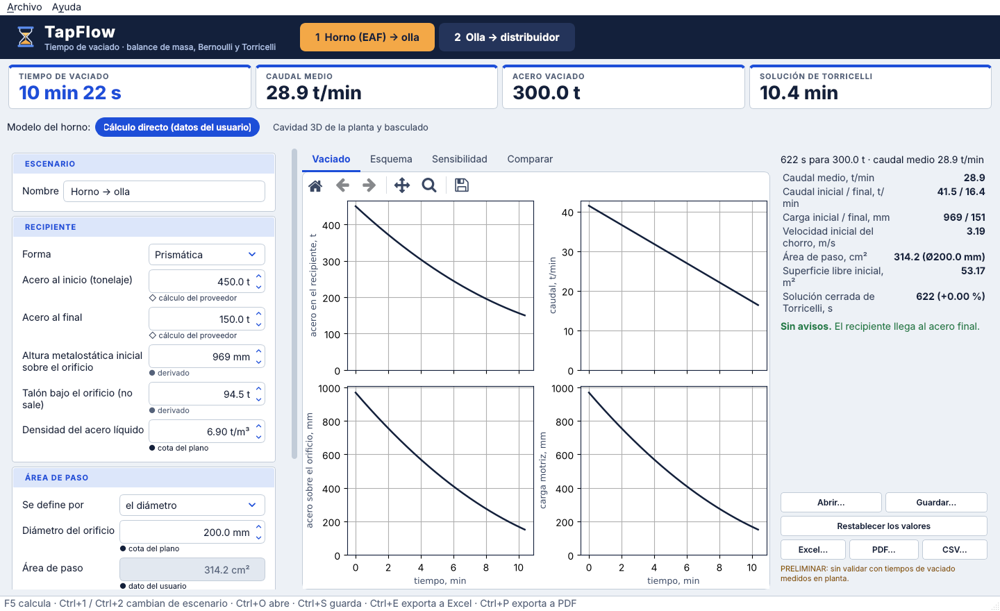
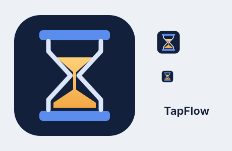

# Diseño de la ventana, icono y nombre

Este documento describe el aspecto de la ventana de TapFlow, su icono y su nombre, y conserva como historial la primera propuesta
de la que salieron.

## 1. Diseño TapFlow

El diseño combina la paleta del diseño «Plano» de la primera propuesta con el acomodo del diseño «Turno». Usa Qt (PySide6, estilo
Fusion) y los componentes heredados de LWD-EAF: tarjetas con el estado de cada dato, selectores, campos numéricos y gráficas de
Matplotlib.

- **Paleta:** fondo gris azulado claro, tarjetas blancas, texto en tinta azul oscura, acento azul de plano técnico y el acero en
  ámbar. La cabecera es de la tinta oscura.
- **Cabecera:** el icono, el nombre y el lema del programa, y los dos escenarios como pasos numerados («1 Horno (EAF) → olla» y
  «2 Olla → distribuidor»); el paso activo va en ámbar.
- **Indicadores:** cuatro cifras grandes de la página activa, siempre a la vista: tiempo de vaciado, caudal medio, acero vaciado y
  la solución de Torricelli (en el horno con cavidad 3D, el ángulo final). La franja superior de cada indicador es azul con un
  resultado al día, gris si los datos cambiaron sin recalcular y roja si el cálculo falló.
- **Página:** a la izquierda, los datos en tarjetas, cada uno con la marca de su estado; al centro, las pestañas de gráficas con
  su barra (vista inicial, desplazar, ampliar, guardar la imagen); a la derecha, la tabla del resultado, los avisos y los botones
  de archivo. La columna derecha se desplaza si la pantalla es baja.
- **Letra:** 10,5 puntos en los controles; columnas que crecen con la letra.
- **Teclado:** F5 calcula; Ctrl+1 y Ctrl+2 cambian de escenario; Ctrl+O abre; Ctrl+S guarda; Ctrl+E y Ctrl+P exportan a Excel y a
  PDF; Ctrl+Shift+C copia el resumen del resultado. La barra de estado los recuerda.

Capturas (sin pantalla; se regeneran con `python -m herramientas.capturas`):

| Vista | 1 440 × 880 | 1 280 × 720 |
|---|---|---|
| Horno (EAF) → olla, cálculo directo | [captura](figuras/ventana/horno_1440x880.png) | [captura](figuras/ventana/horno_1280x720.png) |
| Olla → distribuidor | [captura](figuras/ventana/olla_1440x880.png) | [captura](figuras/ventana/olla_1280x720.png) |
| Horno con la cavidad 3D | [captura](figuras/ventana/horno_cavidad_3d_1440x880.png) | |

## 2. Icono

El icono es un reloj de arena con acero fundido, que representa el tiempo de vaciado. Se dibuja con Qt, sin imágenes de terceros
(`python -m herramientas.iconos`), con los colores del diseño: fondo de la tinta oscura de la cabecera, marco claro, tapas en azul
y acero en ámbar. Está en `modelo_vaciado/interfaz/recursos/icono.png` (256 px) e `icono.ico` (16 a 256 px, el del ejecutable).

## 3. Nombre

El programa se llama **TapFlow**: *tap* es el vaciado del horno por la piquera y *flow*, el flujo que el programa integra. Es el
nombre de la ventana y del ejecutable; el repositorio
(Modelo-Vaciado) y el paquete de Python (`modelo_vaciado`) conservan los suyos.

## 4. Historial: primera propuesta

La primera propuesta tenía cuatro diseños (Magnesita, heredado de LWD-EAF; Colada, oscuro con navegación lateral; Plano,
técnico con pestañas; y Turno, de alto contraste con tablero), cuatro iconos (Chorro, Torricelli, Reloj y Piquera) y seis opciones
de nombre (Modelo-Vaciado, Torricelli, Caudal, VaciaT, Colada-T y Piquera); de ellas se eligió primero VaciaT, que se
sustituyó por TapFlow antes de publicar la versión 0.2.0-preliminar. El código de esa propuesta, con el selector de diseño,
está en la rama `archivo/disenos-iniciales` (commit `f78fadf`), que no se desarrolla. Las capturas y la lámina de iconos se
conservan en `docs/historial/disenos-iniciales/`:

| Diseño | Horno (EAF) → olla | Olla → distribuidor |
|---|---|---|
| Magnesita | [captura](historial/disenos-iniciales/magnesita_horno.png) | [captura](historial/disenos-iniciales/magnesita_olla.png) |
| Colada | [captura](historial/disenos-iniciales/colada_horno.png) | [captura](historial/disenos-iniciales/colada_olla.png) |
| Plano | [captura](historial/disenos-iniciales/plano_horno.png) | [captura](historial/disenos-iniciales/plano_olla.png) |
| Turno | [captura](historial/disenos-iniciales/turno_horno.png) | [captura](historial/disenos-iniciales/turno_olla.png) |

Iconos: [lámina](historial/disenos-iniciales/iconos.png).
