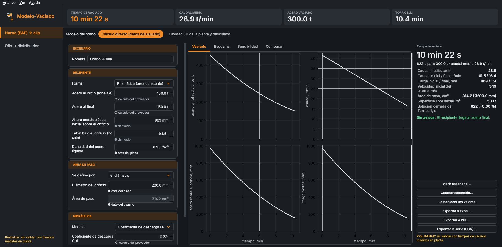
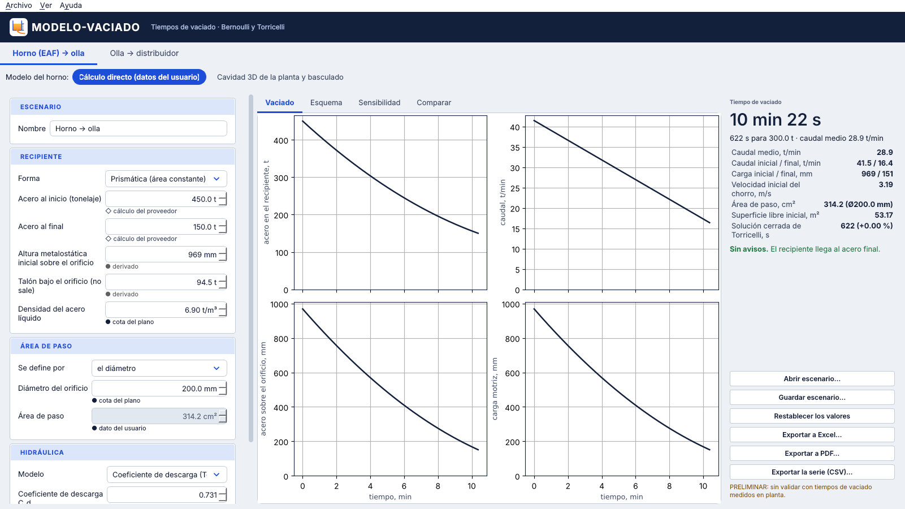
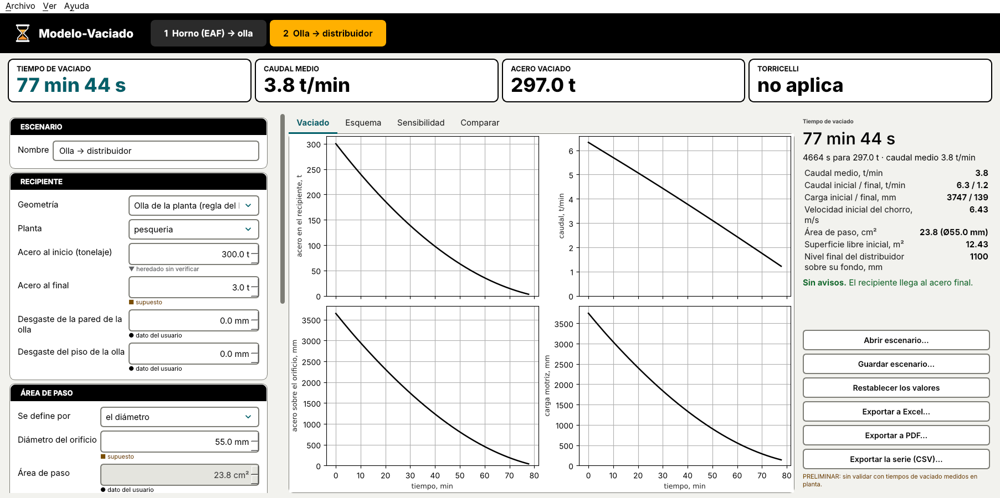
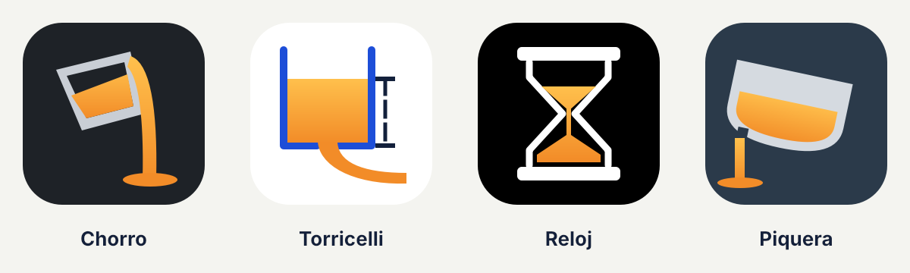

# Diseños de la ventana, iconos y nombres

Este documento presenta las propuestas de aspecto de la ventana, las opciones de icono y las opciones de nombre del programa. Ninguna
está elegida: la elección es una decisión abierta (decisiones N1 a N3 de [pendientes.md](pendientes.md)).

## 1. Diseños

Los cuatro diseños usan Qt (PySide6, estilo Fusion) y los mismos componentes: tarjetas con el estado de cada dato, selectores,
gráficas de Matplotlib y la columna de resultado. Cambian la paleta, el tamaño de la letra, la hoja de estilo y el acomodo de la
ventana. Se eligen en el menú «Ver → Diseño de la ventana» o al abrir el programa con `python vaciado.py --diseno <nombre>`. El
escenario en pantalla pasa al diseño nuevo.

| Diseño | Paleta | Acomodo | Uso previsto |
|---|---|---|---|
| Magnesita (actual) | Claro, arena y verde escoria | Pestañas arriba | El heredado de LWD-EAF, como referencia |
| Colada | Oscuro, grafito y naranja de acero fundido | Navegación lateral e indicadores en la cabecera | Salas de control con poca luz |
| Plano | Claro, blanco y azul de plano técnico | Barra de marca y pestañas planas | Escritorio de ingeniería y capturas para informes |
| Turno | Alto contraste, negro, blanco, verde azulado y ámbar | Tablero: pasos numerados e indicadores grandes | Pantalla de piso de planta o de turno |

**Indicadores.** Los diseños Colada y Turno muestran siempre cuatro cifras de la página activa: tiempo de vaciado, caudal medio,
acero vaciado y la comprobación de Torricelli (en el horno con cavidad 3D, el ángulo final).

**Letra.** El diseño Turno usa letra de 11,5 puntos (10 en los demás), bordes de 2 px y columnas más anchas.

Capturas (ventana de 1 480 × 900, sin pantalla; se regeneran con `python -m herramientas.capturas`):

| Diseño | Horno (EAF) → olla | Olla → distribuidor |
|---|---|---|
| Magnesita | [captura](figuras/disenos/magnesita_horno.png) | [captura](figuras/disenos/magnesita_olla.png) |
| Colada | [captura](figuras/disenos/colada_horno.png) | [captura](figuras/disenos/colada_olla.png) |
| Plano | [captura](figuras/disenos/plano_horno.png) | [captura](figuras/disenos/plano_olla.png) |
| Turno | [captura](figuras/disenos/turno_horno.png) | [captura](figuras/disenos/turno_olla.png) |

## 2. Iconos

Los iconos se dibujan con Qt, sin imágenes de terceros (`python -m herramientas.iconos`). Cada opción tiene un PNG de 256 px y un
ICO de 16 a 256 px en `modelo_vaciado/interfaz/recursos/iconos/`. Cada diseño nuevo usa uno; el de Magnesita conserva el icono
de LWD-EAF.

| Opción | Motivo | Diseño que lo usa |
|---|---|---|
| Chorro | Olla de colada vertiendo un chorro de acero | Colada |
| Torricelli | Depósito con el orificio en el fondo, la parábola del chorro y la cota de la carga | Plano |
| Reloj | Reloj de arena con acero fundido: el tiempo de vaciado | Turno |
| Piquera | Horno basculado con el chorro por la piquera excéntrica | Ninguno (opción libre) |

## 3. Nombres

El nombre actual de la ventana y del ejecutable, «Modelo-Vaciado», es el del repositorio y es provisional. El nombre anterior,
«Vaciado-EAF», ya no describe el alcance, que incluye la olla.

| Nombre | Idea | Observación |
|---|---|---|
| Modelo-Vaciado | Descriptivo, igual que el repositorio | Neutro; no distingue el programa de otros modelos |
| Torricelli | La ley en la que se basa el cálculo | Corto y fácil de recordar; es un nombre propio de uso común |
| Caudal | La magnitud que el programa integra | Genérico |
| VaciaT (tiempo de vaciado) | Abreviatura del objetivo | Corto para el ejecutable; poco descriptivo sin explicación |
| Colada-T | Tiempo de colada, del horno a la olla y al distribuidor | Puede confundirse con la colada continua |
| Piquera | El orificio del horno | No cubre la olla |

Cambiar el nombre afecta a `NOMBRE_APP` (`modelo_vaciado/ventana.py`) y a `NOMBRE` (`empaquetado/construir.py`); el paquete de
Python (`modelo_vaciado`) puede conservar su nombre.
